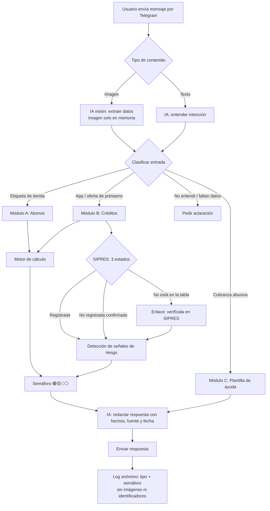

# Cuentas Claras 🧾
### Asistente por mensajería que revela el costo real de un crédito antes de que lo contrates

> **AI Hackathon por México — Mexico Tech Week × Clara**
> Viernes 30 de octubre de 2026 · 9:00 a 18:00 h · Ciudad de México
> Proyecto creado durante el [AI Hackathon por México](https://hackathon.clara.com/)

> **Convención de este documento:** todo dato que no pudimos comprobar está marcado como **POR VERIFICAR**. No se usa en la demo hasta confirmarlo.

---

## Índice

1. [Contexto del hackathon](#1-contexto-del-hackathon)
2. [El problema](#2-el-problema)
3. [La solución](#3-la-solución)
4. [Usuarios objetivo](#4-usuarios-objetivo)
5. [Flujo general](#5-flujo-general)
6. [Flujo detallado por módulo](#6-flujo-detallado-por-módulo)
7. [Arquitectura técnica (n8n)](#7-arquitectura-técnica-n8n)
8. [Esquema de datos](#8-esquema-de-datos)
9. [Fórmulas y cálculos](#9-fórmulas-y-cálculos)
10. [Reglas del semáforo](#10-reglas-del-semáforo)
11. [Fuentes de información oficiales](#11-fuentes-de-información-oficiales)
12. [Prompts de IA](#12-prompts-de-ia)
13. [Resultados esperados](#13-resultados-esperados)
14. [Plan de trabajo del día](#14-plan-de-trabajo-del-día)
15. [Guion de demo](#15-guion-de-demo)
16. [Riesgos y mitigaciones](#16-riesgos-y-mitigaciones)
17. [Checklist de cumplimiento](#17-checklist-de-cumplimiento)
18. [Roadmap](#18-roadmap)
- [Pendientes al llegar al evento](#pendientes-al-llegar-al-evento)
- [Anexo A — Resumen de cambios](#anexo-a--resumen-de-cambios)
- [Anexo B — Lista POR VERIFICAR](#anexo-b--lista-por-verificar)

---

## 1. Contexto del hackathon

### Reglas obligatorias

| # | Regla | Cómo la cumplimos |
|---|---|---|
| 1 | Prototipo funcional con IA, construido durante el evento | Bot de **Telegram** (WhatsApp solo si conecta a la primera) en n8n + LLM con visión |
| 2 | Usar al menos una fuente pública oficial mexicana | Banxico (API SIE + RIB) y Condusef (SIPRES) en el MVP; Buró de Entidades Financieras y Profeco (QQP) en roadmap |
| 3 | Documentar fuente, fecha/vigencia y problema | Cada respuesta del bot cita fuente + fecha de consulta; este documento |
| 4 | Priorizar beneficio público sobre comercial | Gratuito, sin venta de productos financieros, sin publicidad, sin recomendar empresas |
| 5 | Referencia y enlace visible al hackathon | Mensaje de bienvenida del bot + última línea de cada respuesta |

### Criterios de evaluación

| Criterio | Peso | Qué mostramos |
|---|---|---|
| Beneficio público para México | **30%** | Ayuda a familias de bajos ingresos a evitar sobreendeudamiento, abonos con sobrecosto alto y ofertas de crédito con señales de riesgo |
| Prototipo funcional | **25%** | Demo en vivo con 3 casos |
| Uso de IA | **20%** | Visión (lee etiquetas y capturas), extracción estructurada, detección de señales de riesgo, explicación en lenguaje simple |
| Uso de fuentes oficiales | **15%** | MVP: Banxico (API SIE + RIB) y Condusef (SIPRES), todas citadas con fecha |
| Usabilidad y claridad | **10%** | Una foto → un semáforo. Cero apps nuevas |

### Tiempos reales

| Bloque | Horario | Duración |
|---|---|---|
| Desarrollo 1 | 10:30–13:00 | 2 h 30 min |
| Desarrollo 2 | 13:45–16:00 | 2 h 15 min |
| **Total desarrollo** | | **4 h 45 min por persona (2 personas = 9 h 30 min-persona)** |
| Demos ante jurado | 16:00–17:30 | |

---

## 2. El problema

Millones de familias toman decisiones de crédito **sin saber cuánto les cuestan realmente**:

- **Tiendas de abonos:** anuncian "$149 semanales" en grande y el costo total queda en segundo plano. En nuestro caso de prueba, el costo total es casi el doble del precio de contado (§9.5, caso T1).
- **Apps de préstamo con prácticas abusivas** (Condusef las llama "montadeudas"): prometen dinero inmediato, depositan menos de lo ofrecido, cobran intereses altos en plazos cortísimos y, según alertas de Condusef y autoridades, **presionan al deudor usando sus contactos y fotos**.
- **El consejo oficial existe pero no llega:** "revisa el SIPRES", "compara el CAT"... nadie lo hace parado en el pasillo de una tienda o con una emergencia encima.

> El término "montadeudas" se usa aquí solo para describir el fenómeno, tal como lo hace Condusef. **El bot nunca lo aplica a una empresa concreta.**

**Datos de contexto** (citar en el pitch):

| Dato | Fuente |
|---|---|
| Condusef ha identificado y dado de baja más de 600 apps de préstamo fraudulentas | Condusef vía El Imparcial (sep 2024) |
| Modus operandi: depósitos menores a lo prometido, intereses abusivos, plazos cortos, luego difamación y amenazas | Alerta CDMX vía El Imparcial (oct 2025) |
| 55% de las personas ya tuvo contacto directo o indirecto con estas apps; las víctimas acuden primero a Facebook antes que a autoridades | Confianzómetro 2026 (estudio publicado por Tala, app de préstamos registrada — citar como tal) |
| La falta de registro en SIPRES es la principal señal de alerta | Condusef |

---

## 3. La solución

**Cuentas Claras** es un asistente por mensajería (Telegram en el prototipo; WhatsApp como canal objetivo) que, con **una foto o un mensaje**, te dice:

1. **¿Cuánto te cuesta de verdad?** — Costo total, sobrecosto y CAT implícito estimado.
2. **¿Está registrada?** — Estado en el SIPRES de Condusef, con fecha de consulta, o el enlace para que lo verifiques.
3. **¿Hay señales de riesgo?** — Anticipos, permisos a contactos/fotos, depósitos incompletos.
4. **¿Qué alternativa tienes?** — Apartar el abono y comprar de contado; ahorrar en CETES.

### Propuesta de valor en una frase

> *"El consejo oficial dice 'revisa el SIPRES y compara el CAT'. Nosotros lo hacemos por ti, en segundos, desde tu app de mensajería."*

### Dos puertas de entrada, un mismo motor

| Entrada | Ejemplo | Salida |
|---|---|---|
| 🏪 **Etiqueta / folleto de tienda** | Foto de "TV 55'' — $149 semanales × 104 semanas" | Costo total, sobrecosto %, CAT implícito, alternativa de ahorro |
| 📱 **App u oferta de préstamo** | "¿Está registrada [nombre]?" o captura de la oferta | Estado SIPRES, señales de riesgo, costo real, qué hacer |
| 🆘 **"Me están presionando por un préstamo"** | "Me amenazan y escriben a mis contactos" | Pasos inmediatos y canales oficiales (plantilla fija) |

---

## 4. Usuarios objetivo

| Perfil | Situación | Lo que necesita |
|---|---|---|
| Familia de bajos ingresos | Compra electrodomésticos en abonos semanales | Saber el costo total antes de firmar |
| Persona con emergencia económica | Busca "préstamo rápido sin buró" en su celular | Saber si la empresa está registrada antes de darle sus datos |
| Adulto mayor / baja alfabetización digital | Recibe ofertas de crédito por mensajería o redes | Una respuesta simple con semáforo |
| Persona con cobranza abusiva | Recibe amenazas, sus contactos son acosados | Pasos claros y a quién acudir |

---

## 5. Flujo general



> Notas de voz quedan fuera del MVP (roadmap §18).

---

## 6. Flujo detallado por módulo

### Módulo A — Etiqueta de tienda (abonos)

| Paso | Acción | Herramienta | Salida |
|---|---|---|---|
| A1 | Recibir foto de etiqueta / folleto | Telegram → n8n | Imagen (solo en memoria) |
| A2 | Extraer: producto, precio contado, abono, periodicidad, nº de pagos, enganche, comisiones (iniciales / periódicas), seguros | LLM con visión | JSON (ver §8) |
| A3 | Validar coherencia (abono × pagos ≥ precio contado − enganche; campos obligatorios presentes) | Nodo Code | JSON validado o pregunta al usuario |
| A4 | Calcular costo total, sobrecosto, CAT implícito | Nodo Code (§9) | Métricas |
| A5 | Consultar tasa CETES 28 días | API SIE Banxico (**ID de serie POR VERIFICAR**) | Tasa + fecha |
| A6 | Calcular semanas para juntar el contado apartando el abono | Nodo Code (§9.3) | Nº de semanas |
| A7 | Asignar semáforo | Reglas (§10) | 🟢 / 🟡 / 🔴 |
| A8 | Redactar respuesta en lenguaje simple con fuentes | LLM | Mensaje final |
| A9 | Descartar imagen | n8n (no se persiste el binario) | — |

**Ejemplo de respuesta (caso de prueba T1, §9.5):**

> 🔴 **En abonos, esta TV te cuesta $15,496. De contado cuesta $7,999.**
> Pagas **$7,497 extra (≈94% más)** en 104 semanas.
> CAT implícito estimado: **≈110.6% anual** (informativo, sin IVA). Referencia regulada: [CAT promedio RIB Banxico — POR VERIFICAR].
>
> 💡 **Alternativa:** si apartas los mismos $149 cada semana, juntas el precio de contado en **54 semanas o menos** (menos si lo ahorras en CETES) y evitas pagar **≈$7,450** de más.
>
> 📊 Fuentes: cálculo propio con los datos de la etiqueta; Banxico RIB Créditos Personales (datos a [fecha — POR VERIFICAR]).
> Hecho en el [AI Hackathon por México](https://hackathon.clara.com/)

---

### Módulo B — App u oferta de préstamo

| Paso | Acción | Herramienta | Salida |
|---|---|---|---|
| B1 | Recibir nombre de la empresa/app, captura de la oferta o de las condiciones | Telegram → n8n | Imagen / texto |
| B2 | Extraer: nombre comercial, razón social, monto ofrecido, monto depositado, monto a pagar, plazo, comisiones, permisos solicitados, si pide anticipo | LLM con visión | JSON (ver §8) |
| B3 | Buscar la entidad en la tabla `entidades_sipres` y resolver **uno de tres estados** | Nodo Code / lookup | `registrada` · `no_registrada_confirmada` · `sin_verificar` |
| B4 | Detectar señales de riesgo con evidencia textual | Reglas + LLM | Lista de hechos |
| B5 | Calcular costo real y CAT implícito | Nodo Code (§9) | Métricas |
| B6 | Comparar contra CAT de referencia regulado | Tabla `cat_referencia` (RIB Banxico) | Diferencia vs. referencia |
| B7 | Asignar semáforo | Reglas (§10) | 🟢 / 🟡 / 🔴 / ⚪ |
| B8 | Redactar respuesta con **hechos verificables** y fecha | LLM | Mensaje final |

#### Los tres estados de SIPRES

| Estado | Cuándo aplica | Qué dice el bot | ¿Afecta el semáforo? |
|---|---|---|---|
| ✅ `registrada` | Está en la tabla con estado "registrada" y fecha de consulta | "Aparece registrada en el SIPRES de Condusef (consulta del [fecha])." | Permite 🟢 si no hay otras señales |
| ❌ `no_registrada_confirmada` | Está en la tabla porque alguien del equipo la buscó manualmente en SIPRES y **no obtuvo resultado** | "No la encontramos en el SIPRES de Condusef (búsqueda manual del [fecha])." | 🔴 |
| ❔ `sin_verificar` | **No está en la tabla local** | "No la tenemos en nuestra base. Verifícala tú aquí: [enlace SIPRES]." | **No asigna 🔴 por esta razón.** Si no hay otras señales → ⚪ |

**Ejemplo de respuesta — oferta con señales de riesgo (usar solo entidades con alerta pública de Condusef):**

> 🔴 **Encontramos señales de riesgo en esta oferta**
> • No la encontramos en el SIPRES de Condusef (búsqueda manual del 30/10/2026).
> • Pide acceso a tus contactos y fotos. Condusef recomienda no otorgar estos permisos a apps de préstamo.
> • Ofrece $3,000, pero deposita $2,100 y pide $3,600 en 7 días: pagas **$1,500 por recibir $2,100**. CAT implícito estimado: **más de 1,000%** (informativo, sin IVA).
>
> ✅ **Antes de dar tus datos**, verifica en el SIPRES: [enlace]. Si ya instalaste la app, revisa y retira sus permisos.
>
> 📊 Fuentes: SIPRES, Condusef (búsqueda del 30/10/2026); cálculo propio con los datos de la captura.
> Hecho en el [AI Hackathon por México](https://hackathon.clara.com/)

**Ejemplo de respuesta — entidad que no está en la tabla:**

> ⚪ **No pudimos verificar a "[nombre]" en nuestra base** (actualizada el 30/10/2026).
> 👉 Verifícala tú en el SIPRES de Condusef: [enlace].
> Con los datos que enviaste: pagas **$[total] por recibir $[depositado]** en [plazo] días. CAT implícito estimado: [valor].
>
> 📊 Fuente: cálculo propio con los datos de la captura.
> Hecho en el [AI Hackathon por México](https://hackathon.clara.com/)

**Ejemplo de respuesta — entidad registrada con costo alto:**

> 🟡 **"[nombre]" aparece registrada en el SIPRES** (consulta del 30/10/2026), **pero el crédito es caro.**
> CAT implícito estimado: [valor] vs. [referencia RIB — POR VERIFICAR] promedio regulado.
> Registrada no significa conveniente: compara antes de aceptar.
>
> 📊 Fuentes: SIPRES, Condusef; Banxico RIB.
> Hecho en el [AI Hackathon por México](https://hackathon.clara.com/)

---

### Módulo C — Cobranza abusiva (plantilla fija en el MVP)

| Paso | Acción |
|---|---|
| C1 | Detectar intención (amenazas, mensajes a contactos, cobros que no reconoce) |
| C2 | Responder con calma, sin juicio y sin calificar a la empresa |
| C3 | Pasos inmediatos: revisar y retirar permisos de la app, no hacer pagos bajo presión, guardar evidencia (mensajes, condiciones, capturas de permisos) |
| C4 | Canales oficiales: Condusef y Policía Cibernética de su estado — **teléfonos y enlaces POR VERIFICAR antes de la demo** |
| C5 | Mensaje sugerido para avisar a sus contactos que no respondan a cobradores |

> ⚠️ Este módulo es **solo orientación**. No da asesoría legal y siempre remite a autoridades. En el MVP es una plantilla de texto; no hay lógica adicional.

---

## 7. Arquitectura técnica (n8n)

### Componentes

| Capa | Herramienta | Notas |
|---|---|---|
| Canal | **Telegram Bot API (principal)** | Bot creado al llegar; WhatsApp solo si conecta al primer intento (si no, roadmap) |
| Orquestación | n8n | Toda la lógica se construye **durante el evento** |
| IA visión + texto | LLM con visión (Claude / GPT / modelo open source que ofrezca Clara) | Extracción a JSON estricto |
| Datos en vivo | API SIE de Banxico | Token gratuito |
| Datos capturados | Google Sheets / tabla en n8n | `entidades_sipres`, `cat_referencia` — con `fecha_consulta` |
| Cálculos | Nodo Code (JavaScript) | Determinístico, no depende del LLM |
| Logs | Sheet | Solo tipo de consulta, semáforo y fecha (ver requisitos de privacidad) |

### Requisitos de privacidad (obligatorios en el flujo)

| # | Requisito | Cómo se implementa |
|---|---|---|
| P1 | **No guardar imágenes** | El binario se pasa al LLM y se descarta; ningún nodo lo escribe en disco, Sheet o almacenamiento |
| P2 | **No guardar teléfonos ni identificadores** | El `chat_id` de Telegram se usa solo en memoria para responder; no se escribe en el log |
| P3 | **Logs anónimos** | El log solo tiene: `fecha` (día), `tipo_entrada`, `semaforo`, `estado_sipres` |
| P4 | No guardar el texto de la conversación | Ni mensajes del usuario ni respuestas se persisten |
| P5 | Aviso al usuario | El mensaje de bienvenida dice que no se guardan fotos ni datos personales |

### Workflow n8n (nodos)

```
[Telegram Trigger]
   → [Switch: tipo de mensaje]
        ├─ imagen → [Telegram: descargar archivo (en memoria)] → [LLM visión: extraer JSON]
        └─ texto  → [LLM: extraer JSON]
   → [Code: validar JSON]  ──(faltan datos)──→ [Telegram: pedir aclaración]
   → [Switch: tipo_entrada]
        ├─ etiqueta_tienda → [HTTP: Banxico SIE CETES] → [Code: cálculos A]
        ├─ oferta_credito  → [Lookup: entidades_sipres → 3 estados] → [Code: cálculos B + señales]
        ├─ cobranza        → [Set: plantilla Módulo C]
        └─ desconocido     → [Set: pedir aclaración]
   → [Code: semáforo]
   → [LLM: redactar respuesta con hechos, fuente y fecha]
   → [Telegram: enviar mensaje]
   → [Sheet: log anónimo (fecha, tipo_entrada, semaforo, estado_sipres)]
```

### Llamadas a la API de Banxico

> ⚠️ **POR VERIFICAR con el token:** el nombre del header (`Bmx-Token`) y todos los IDs de serie de abajo provienen de documentación de terceros, no de una consulta propia. **Paso obligatorio antes de usarlos:** abrir el catálogo de series oficial, confirmar cada ID y su título, y hacer una llamada de prueba.

```bash
BASE="https://www.banxico.org.mx/SieAPIRest/service/v1"

# CETES 28 días — último dato (ID SF282: POR VERIFICAR)
curl -H "Bmx-Token: $TOKEN" "$BASE/series/SF282/datos/oportuno"

# Inflación anual — último dato (ID SP30578: POR VERIFICAR)
curl -H "Bmx-Token: $TOKEN" "$BASE/series/SP30578/datos/oportuno"
```

Respuesta esperada (estructura — **POR VERIFICAR** con la primera llamada real):

```json
{
  "bmx": {
    "series": [
      {
        "idSerie": "SF282",
        "titulo": "...",
        "datos": [{ "fecha": "DD/MM/AAAA", "dato": "X.XX" }]
      }
    ]
  }
}
```

> Confirmar que `titulo` corresponda a la serie esperada. Usar `datos[0].fecha` como **fecha de vigencia** que se cita en la respuesta.

---

## 8. Esquema de datos

### JSON de extracción (salida del LLM)

```json
{
  "tipo_entrada": "etiqueta_tienda | oferta_credito | cobranza | desconocido",
  "confianza_extraccion": 0.0,

  "producto": {
    "descripcion": "string | null",
    "precio_contado": null,
    "tienda": "string | null"
  },

  "credito": {
    "otorgante_nombre_comercial": "string | null",
    "otorgante_razon_social": "string | null",
    "monto_ofrecido": null,
    "monto_depositado": null,
    "enganche": null,
    "abono": null,
    "periodicidad": "semanal | quincenal | mensual | diario | unico | null",
    "numero_pagos": null,
    "plazo_dias": null,
    "monto_total_a_pagar": null,
    "comisiones": [{ "concepto": "string", "monto": 0, "momento": "inicial | periodico | final" }],
    "seguros": [{ "concepto": "string", "monto": 0, "momento": "inicial | periodico" }],
    "cat_publicado": null
  },

  "senales_riesgo": {
    "pide_anticipo": false,
    "pide_permiso_contactos": false,
    "pide_permiso_fotos_archivos": false,
    "deposito_menor_a_ofrecido": false,
    "plazo_menor_a_15_dias": false,
    "presion_urgencia": false,
    "texto_evidencia": ["string"]
  },

  "datos_faltantes": ["string"]
}
```

> Si `datos_faltantes` no está vacío o `confianza_extraccion < 0.7`, el bot **pregunta** antes de calcular (caso de prueba T10, §9.5).

### Tabla `entidades_sipres` (capturada manualmente al llegar)

| Campo | Ejemplo / valores |
|---|---|
| `nombre_comercial` | Nombre de la app o marca |
| `razon_social` | Razón social, si aparece |
| `estado_verificacion` | `registrada` · `no_registrada_confirmada` |
| `terminos_buscados` | Términos usados en la búsqueda manual (nombre comercial, razón social) |
| `sector` | SOFOM ENR / Banco / SOFIPO / ... (si aparece) |
| `telefono_oficial` | Si SIPRES lo muestra (**POR VERIFICAR** qué campos muestra) |
| `sitio_oficial` | Ídem |
| `alerta_publica_condusef` | URL de la alerta, si existe (requisito para usarla en la demo) |
| `fuente_url` | URL del SIPRES |
| `fecha_consulta` | 2026-10-30 |
| `verificado_por` | Iniciales de quien hizo la búsqueda |

> El tercer estado (`sin_verificar`) **no se guarda**: es la ausencia de la entidad en esta tabla.

### Tabla `cat_referencia` (de RIB Banxico)

| Campo | Ejemplo |
|---|---|
| `tipo_credito` | personal / microcrédito / bienes duraderos / nómina |
| `cat_promedio_ponderado` | **POR VERIFICAR** (capturar del RIB) |
| `fecha_datos` | Ej. "datos a agosto 2025" |
| `fuente_url` | URL del PDF RIB |

### Tabla `log_consultas` (anónima)

| Campo | Ejemplo |
|---|---|
| `fecha` | 2026-10-30 |
| `tipo_entrada` | etiqueta_tienda |
| `semaforo` | rojo |
| `estado_sipres` | sin_verificar / n.a. |

---

## 9. Fórmulas y cálculos

> Todos los cálculos se hacen en código (determinísticos). El LLM **solo** extrae datos y redacta.

### 9.1 Costo total y sobrecosto

```
costo_total     = enganche
                + (abono × numero_pagos)
                + Σ comisiones_iniciales + Σ comisiones_finales
                + Σ (comisiones_periodicas + seguros_periodicos) × numero_pagos
                + Σ seguros_iniciales
sobrecosto_$    = costo_total − precio_contado
sobrecosto_%    = sobrecosto_$ / precio_contado × 100
```

Para préstamos de apps:

```
dinero_recibido = monto_depositado        (no el ofrecido)
costo_credito_$ = monto_total_a_pagar − dinero_recibido
```

### 9.2 CAT implícito estimado

Se busca la tasa periódica `r` que iguala lo recibido con el valor presente de los pagos:

```
principal_neto = Σ (pago_t / (1 + r)^t),  t = 1..n

CAT_implícito = (1 + r)^(periodos_por_año) − 1
periodos_por_año: semanal = 52, quincenal = 24, mensual = 12, diario = 365
```

**Cómo entran comisiones y seguros al flujo de pagos** (sí se incluyen, porque son dinero que el usuario paga por el crédito):

| Cargo | Tratamiento | Razón |
|---|---|---|
| Enganche | Se resta del principal: `principal_neto = precio_contado − enganche − ...` | Es pago de contado, no se financia |
| Comisión / seguro **inicial** | Se resta del principal | Equivale a recibir menos dinero financiado |
| Comisión / seguro **periódico** | Se suma al pago: `pago = abono + cargos_periodicos` | Sale del bolsillo en cada periodo |
| Comisión **final** | Fuera del MVP: se reporta en el costo total pero no en el CAT | Requiere un flujo de pagos no uniforme; va a roadmap |
| Apps: monto depositado | `principal_neto = monto_depositado` | Lo descontado ya está reflejado |

Para pago único (apps a 7, 14 o 30 días):

```
r  = monto_total_a_pagar / monto_depositado − 1
CAT_implícito = (1 + r)^(365 / plazo_dias) − 1
```

**Regla de presentación:** si el CAT implícito supera 1,000%, el bot muestra "**más de 1,000%**" y pone el énfasis en pesos ("pagas $X por recibir $Y"). Las cifras exactas de millones de % no ayudan al usuario.

> **Aclaración obligatoria en la respuesta:** "CAT estimado con fines informativos, sin IVA; puede diferir del CAT oficial calculado conforme a la metodología de Banxico."

**Implementación (nodo Code, JavaScript) — probada con los casos de §9.5:**

```javascript
const R_MIN = 0;        // tasa periódica mínima (0%)
const R_MAX = 10;       // tasa periódica máxima (1,000% por periodo)
const ITER  = 200;
const EPS   = 1e-12;

// Valor presente de una anualidad; protege el caso r → 0
function vpAnualidad(r, pago, n) {
  if (Math.abs(r) < EPS) return pago * n;
  return pago * (1 - Math.pow(1 + r, -n)) / r;
}

function tasaPeriodica(principal, pago, n) {
  if (!(principal > 0) || !(pago > 0) || !(n >= 1)) {
    return { r: null, motivo: "datos_invalidos" };
  }
  const total = pago * n;
  if (Math.abs(total - principal) < 0.005) return { r: 0, motivo: "sin_costo" };
  if (total < principal) return { r: null, motivo: "pagos_menores_al_principal" };
  if (vpAnualidad(R_MAX, pago, n) > principal) {
    return { r: R_MAX, motivo: "fuera_de_rango" };   // tasa > 1,000% por periodo
  }
  let lo = R_MIN, hi = R_MAX;                        // búsqueda acotada
  for (let i = 0; i < ITER; i++) {
    const m = (lo + hi) / 2;
    if (vpAnualidad(m, pago, n) > principal) lo = m; else hi = m;
  }
  return { r: (lo + hi) / 2, motivo: "ok" };
}

function catImplicito(principal, pago, n, periodosPorAnio) {
  const { r, motivo } = tasaPeriodica(principal, pago, n);
  if (r === null) return { cat: null, motivo };
  return { cat: Math.pow(1 + r, periodosPorAnio) - 1, motivo };
}

function catPagoUnico(depositado, totalPagar, plazoDias) {
  if (!(depositado > 0) || !(totalPagar > 0) || !(plazoDias >= 1)) {
    return { cat: null, motivo: "datos_invalidos" };
  }
  if (totalPagar < depositado) return { cat: null, motivo: "pagos_menores_al_principal" };
  const r = totalPagar / depositado - 1;
  return { cat: Math.pow(1 + r, 365 / plazoDias) - 1, motivo: r === 0 ? "sin_costo" : "ok" };
}

function formatoCAT(cat) {
  if (cat === null) return null;
  if (cat > 10) return "más de 1,000%";
  return (cat * 100).toFixed(1) + "%";
}
```

### 9.3 Alternativa: apartar el abono / ahorrar en CETES

```
tasa_semanal = (1 + tasa_cetes_anual × 28/360)^(1/4) − 1   (aproximación)

saldo_k = saldo_(k−1) × (1 + tasa_semanal) + abono

semanas_para_contado = primer k donde saldo_k ≥ precio_contado
ahorro_vs_credito    = costo_total − (abono × semanas_para_contado)
```

> Con tasa 0% el resultado es el **tope máximo** de semanas; con cualquier tasa positiva de CETES el número baja. Por eso el bot dice "**N semanas o menos**" aunque la tasa de CETES no esté disponible.

```javascript
function semanasParaContado(precio, abono, tasaAnual) {
  const ts = Math.pow(1 + tasaAnual * 28 / 360, 1 / 4) - 1;
  let saldo = 0, k = 0;
  while (saldo < precio && k < 1000) { saldo = saldo * (1 + ts) + abono; k++; }
  return { semanas: k, aportado: abono * k, saldo };
}
```

### 9.4 Ajuste por inflación (comparativo honesto)

```
precio_futuro = precio_contado × (1 + inflacion_anual)^(semanas_para_contado / 52)
```

> Mostrar ambos: "esperar te cuesta $X por inflación, pero te ahorras $Y de intereses". Depende de la serie de inflación (**ID POR VERIFICAR**); si no se confirma a tiempo, esta línea se omite.

### 9.5 Casos de prueba

> Valores calculados con el código de §9.2–9.3 (ejecutado en Node.js y verificado con una implementación independiente en Python). Las tasas de CETES marcadas como "ficticia" son **solo entradas de prueba**, no datos reales.

| ID | Caso | Entradas | Resultado esperado |
|---|---|---|---|
| **T1** | **Abonos (obligatorio)** | Contado $7,999 · abono $149 × 104 semanas · enganche $0 · sin comisiones | Costo total **$15,496** · sobrecosto **$7,497 (93.7% ≈ 94%)** · r semanal **1.4429%** · CAT implícito **110.63% anual** · semáforo 🔴 (sobrecosto ≥ 50%) |
| T2 | Abonos con enganche y cargos | Contado $7,999 · enganche $500 · comisión inicial $300 · abono $149 + seguro $10/semana × 104 | Costo total **$17,336** · sobrecosto **$9,337 (116.7%)** · principal neto $7,199 · pago $159 · CAT implícito **165.46%** (sin cargos sería 129.37%) |
| T3 | Sin costo (r → 0) | Principal $1,000 · pago $100 × 10 | r = 0 · CAT **0%** · motivo `sin_costo` · sin división entre cero |
| T4 | Pagos menores al principal | Principal $1,000 · pago $90 × 10 | CAT `null` · motivo `pagos_menores_al_principal` → el bot pide revisar los datos |
| T5 | Pago único 7 días | Depositado $2,000 · paga $2,400 · 7 días | r = 20% · CAT ≈ **1,344,944%** → se muestra "**más de 1,000%**" |
| T6 | Pago único 14 días | Depositado $2,000 · paga $2,400 · 14 días | CAT ≈ **11,497.6%** → "más de 1,000%" |
| T7 | Pago único 30 días | Depositado $2,000 · paga $2,400 · 30 días | CAT **819.1%** → se muestra "819.1%" |
| T8 | Depósito menor al ofrecido | Ofrece $3,000 · deposita $2,100 · paga $3,600 · 7 días | Se calcula sobre **$2,100**: pagas **$1,500 por recibir $2,100** (r = 71.4%) · "más de 1,000%" · señal `deposito_menor_a_ofrecido` = true. Si se calculara (mal) sobre $3,000: r = 20%. A 14 días: ≈126,731,111%; a 30 días: ≈70,371% (ambos "más de 1,000%") |
| T9 | Dato faltante | Contado $7,999 · abono **null** · 104 pagos | CAT `null` · motivo `datos_invalidos` · `datos_faltantes: ["abono"]` → el bot pregunta el abono |
| T10 | Extracción con baja confianza | `confianza_extraccion` = 0.5 | No se calcula; el bot pide una foto más clara o los datos por texto |
| T11 | Apartar el abono sin rendimiento | Contado $7,999 · abono $149 · tasa 0% | **54 semanas** · aportado $8,046 · ahorro vs. crédito **$7,450** |
| T12 | Apartar el abono en CETES | Contado $7,999 · abono $149 · tasa **10% anual (ficticia, solo prueba)** | **52 semanas** · aportado $7,748 · saldo $8,143.73 |
| T13 | SIPRES `sin_verificar` sin otras señales | Entidad no presente en la tabla · sin anticipo · sin permisos · depósito = ofrecido | Semáforo ⚪ · respuesta con enlace a SIPRES · **nunca 🔴 por esta causa** |
| T14 | SIPRES `sin_verificar` con señales | Entidad no presente en la tabla · pide permiso a contactos | Semáforo 🔴 por la señal de permisos; el texto aclara que el registro no se pudo verificar |

---

## 10. Reglas del semáforo

> Umbrales **propuestos**; ajustarlos con el equipo durante el evento.

### Módulo A — Etiqueta de tienda

| Semáforo | Condición |
|---|---|
| 🟢 Verde | `sobrecosto_% < 15%` |
| 🟡 Amarillo | `15% ≤ sobrecosto_% < 50%` **o** CAT implícito > CAT de referencia |
| 🔴 Rojo | `sobrecosto_% ≥ 50%` **o** CAT implícito > 2 × CAT de referencia |

### Módulo B — App / oferta de préstamo

| Semáforo | Condición |
|---|---|
| 🔴 Rojo | SIPRES `no_registrada_confirmada` |
| 🔴 Rojo | Pide anticipo para liberar el crédito |
| 🔴 Rojo | Pide acceso a contactos, fotos o archivos |
| 🔴 Rojo | Deposita menos de lo ofrecido sin desglose claro |
| 🟡 Amarillo | SIPRES `registrada`, pero CAT implícito > 1.5 × referencia |
| ⚪ Sin verificar | SIPRES `sin_verificar` (no está en la tabla) **y** ninguna condición roja → respuesta con enlace "verifícala aquí" |
| 🟢 Verde | SIPRES `registrada`, sin señales rojas, CAT ≤ referencia |

> **Prioridad:** cualquier condición roja manda. `sin_verificar` por sí solo **nunca** produce 🔴.
>
> **Importante:** 🟢 significa "no detectamos riesgos con la información oficial consultada en [fecha]", **no** "te recomendamos contratarlo". El bot nunca recomienda contratar un producto ni califica a una empresa; solo reporta hechos con fuente y fecha.
>
> Las reglas que dependen del Buró de Entidades Financieras pasan a roadmap (§18).

---

## 11. Fuentes de información oficiales

### Resumen

| # | Fuente | Institución | Qué extraemos | Tipo de acceso | Se usa en | Alcance |
|---|---|---|---|---|---|---|
| 1 | API SIE | Banxico | Tasa CETES 28d, inflación | API REST (JSON) en vivo | A5, 9.3, 9.4 | **MVP** (IDs POR VERIFICAR) |
| 2 | Reportes de Indicadores Básicos (RIB) | Banxico | CAT promedio por tipo de crédito | PDF → captura manual a tabla | B6, semáforo | **MVP** |
| 3 | SIPRES | Condusef | Estado de registro, datos de contacto oficiales | Portal web → captura manual a tabla | B3 | **MVP** |
| 4 | Buró de Entidades Financieras | Condusef | Quejas, % resolución, sanciones, cláusulas abusivas | Portal web | — | Roadmap |
| 5 | Quién es Quién en los Precios (QQP) | Profeco | Precio de referencia del producto | Portal / datos abiertos | — | Roadmap |

### Detalle por fuente

#### 1. Banxico — API del Sistema de Información Económica (SIE)

| Campo | Valor |
|---|---|
| URL base | `https://www.banxico.org.mx/SieAPIRest/service/v1` |
| Solicitar token (gratis) | https://www.banxico.org.mx/SieAPIRest/service/v1/token |
| Catálogo de series | https://www.banxico.org.mx/SieAPIRest/service/v1/doc/catalogoSeries |
| Formato | JSON |
| Header de autenticación | `Bmx-Token` — **POR VERIFICAR** |

| Serie | ID | Uso | Estado |
|---|---|---|---|
| CETES 28 días | `SF282` | Alternativa de ahorro | **POR VERIFICAR con el token** |
| Inflación anual | `SP30578` | Ajuste por inflación | **POR VERIFICAR con el token** |
| Inflación mensual | `SP30577` | Contexto | POR VERIFICAR (fuente de terceros) |
| Tipo de cambio FIX | `SF63528` | Roadmap | POR VERIFICAR (fuente de terceros) |
| UDIS | `SP68257` | Roadmap | POR VERIFICAR (fuente de terceros) |

> ✅ **Paso obligatorio al llegar:** con el token, buscar cada serie en el catálogo oficial, confirmar ID + título y hacer una llamada de prueba. Si un ID no coincide, se corrige aquí antes de conectarlo al workflow.

#### 2. Banxico — Reportes de Indicadores Básicos (RIB)

| Campo | Valor |
|---|---|
| Qué es | Reportes que comparan condiciones de crédito entre otorgantes regulados |
| Reporte clave | **Indicadores Básicos de Créditos Personales y Microcréditos** (incluye créditos de adquisición de bienes de consumo duradero) |
| Último ubicado | Datos a agosto de 2025 — [PDF](https://www.banxico.org.mx/publicaciones-y-prensa/rib-creditos-personales/%7B57AA71F9-1890-C2BB-1C3B-9C5F54F32173%7D.pdf) |
| ¿Hay uno más reciente? | **POR VERIFICAR** |
| CAT promedio a usar | **POR VERIFICAR** (ubicar la tabla en el PDF) |
| Portal | http://www.banxico.org.mx/PortalTranspCompSistFin/ (**POR VERIFICAR** que siga activo) |
| Limitación | Solo incluye otorgantes regulados; el de tarjetas excluye tiendas departamentales no bancarias. Úsese como **referencia regulada** |

#### 3. Condusef — SIPRES (Sistema de Registro de Prestadores de Servicios Financieros)

| Campo | Valor |
|---|---|
| URL | https://webapps.condusef.gob.mx/SIPRES_N/jsp/pub/index.jsp (**POR VERIFICAR**: obtenida de medios; existe también una versión sin `_N`) |
| Qué obtenemos | Si la entidad está registrada; razón social, sector, domicilio, teléfonos y sitio (**POR VERIFICAR** qué campos muestra) |
| Acceso | Formulario web (sin API pública conocida) |
| Estrategia | Captura manual de 8–10 entidades al llegar, con `estado_verificacion`, `terminos_buscados` y `fecha_consulta` |

**Entidades a capturar:**
- 3–4 apps de préstamo que aparezcan **registradas**
- 3–4 entidades mencionadas en **alertas públicas de Condusef** (guardar la URL de la alerta) — son las únicas que se usan para el caso 🔴 de la demo
- 1–2 tiendas o financieras de abonos

#### 4. Condusef — Buró de Entidades Financieras (roadmap)

| Campo | Valor |
|---|---|
| URL | https://www.buro.gob.mx (**POR VERIFICAR**) |
| Qué ofrece | Reclamaciones, % resueltas a favor del usuario, días de respuesta, sanciones, cláusulas abusivas |
| Por qué está en roadmap | No cabe en las 4 h 45 min de un equipo de 2 |

#### 5. Profeco — Quién es Quién en los Precios (roadmap)

| Campo | Valor |
|---|---|
| Portal | https://qqp.profeco.gob.mx/ (**POR VERIFICAR**) |
| Datos abiertos | Dataset "Quién es Quién en los precios" en datos.gob.mx (frescura **POR VERIFICAR**) |
| Qué ofrece | Precio de contado de referencia de electrodomésticos y línea blanca |

#### Fuentes para el pitch (no oficiales, solo contexto)

| Dato | Fuente |
|---|---|
| +600 apps fraudulentas dadas de baja | [El Imparcial, 2024](https://www.elimparcial.com/dinero/2024/09/17/kardmatch-alerta-sobre-los-fraudes-mas-comunes-al-solicitar-prestamos-en-aplicaciones/) |
| Modus operandi de apps con cobranza abusiva | [Expansión, jul 2026](https://expansion.mx/finanzas-personales/2026/07/01/apps-de-prestamos-montadeudas-advertencias-condusef) |
| Confianzómetro 2026 | [Publimetro, ago 2026](https://www.publimetro.com.mx/noticias/2026/08/18/mexicanos-corren-a-facebook-antes-de-denunciar-fraudes-de-montadeudas/) |

---

## 12. Prompts de IA

### 12.1 Prompt de extracción (visión)

```text
Eres un extractor de datos financieros. Recibes una imagen o texto de:
(a) una etiqueta, folleto o anuncio de venta en abonos, o
(b) una oferta, pantalla o condiciones de una app/empresa de préstamos, o
(c) un mensaje de alguien que dice estar siendo presionado o amenazado por un cobro.

Devuelve SOLO un JSON válido con el esquema proporcionado.

Reglas:
- No inventes números. Si un dato no aparece, usa null y agrégalo a "datos_faltantes".
- Distingue "monto_ofrecido" (lo que prometen) de "monto_depositado" (lo que realmente llega).
- Clasifica cada comisión o seguro por "momento": inicial, periodico o final.
- Marca señales de riesgo solo si hay evidencia explícita; copia la frase en "texto_evidencia".
- Normaliza montos a número sin símbolos ni comas.
- "confianza_extraccion" entre 0 y 1 según qué tan legible y completa es la información.

Esquema:
<<pegar JSON del §8>>
```

### 12.2 Prompt de redacción de respuesta

```text
Eres "Cuentas Claras", un asistente que explica créditos a personas sin
conocimientos financieros. Recibes un JSON con datos extraídos, cálculos,
estado SIPRES y semáforo.

Escribe una respuesta para mensajería:
- Máximo 8 líneas.
- Empieza con el emoji del semáforo y una frase con el costo real en pesos.
- Usa pesos, no porcentajes complicados (el CAT va como dato secundario).
- Si el CAT es mayor a 1,000%, escribe "más de 1,000%".
- Si hay señales de riesgo, enuméralas como HECHOS con viñetas
  (ej. "Pide acceso a tus contactos", "No la encontramos en el SIPRES (búsqueda del [fecha])").
- Según estado_sipres:
  · registrada → "Aparece registrada en el SIPRES de Condusef (consulta del [fecha])."
  · no_registrada_confirmada → "No la encontramos en el SIPRES de Condusef (búsqueda manual del [fecha])."
  · sin_verificar → "No la tenemos en nuestra base. Verifícala aquí: [enlace SIPRES]." (no la califiques)
- Da UNA alternativa concreta con ✅ o 💡.
- Termina con "📊 Fuentes:" citando institución y fecha de consulta.
- Última línea: "Hecho en el AI Hackathon por México: https://hackathon.clara.com/"

Prohibido:
- Recomendar contratar un producto o empresa.
- Calificar a una empresa concreta con palabras como "fraude", "estafa",
  "montadeudas", "ilegal" o "NO uses esta app".
- Afirmar algo que no esté en el JSON.

Tono: claro, cálido, sin tecnicismos, sin regañar.
```

---

## 13. Resultados esperados

### Para el usuario

| Resultado | Cómo se mide en la demo |
|---|---|
| Conoce el costo total real en pesos | El bot muestra el costo total y el sobrecosto |
| Sabe si la empresa aparece registrada | Estado SIPRES con fecha, o enlace para verificar |
| Detecta señales de riesgo antes de dar sus datos | Lista de hechos con evidencia |
| Tiene una alternativa concreta | Semanas para juntar el contado |
| Si recibe cobranza abusiva, sabe qué hacer | Plantilla con pasos y canales oficiales |
| Su privacidad está protegida | No se guardan imágenes, teléfonos ni conversaciones |

### Para el jurado (metas del prototipo)

| Meta | Indicador de éxito |
|---|---|
| Funciona en vivo | 3 casos procesados correctamente frente al jurado |
| Tiempo de respuesta | < 15 segundos por consulta |
| Cálculo correcto | Los 14 casos de prueba de §9.5 dan el valor esperado |
| Precisión de extracción | Montos correctos en las fotos de prueba |
| Fuentes trazables | Cada respuesta cita institución y fecha |
| Claridad | Un juez entiende el resultado sin explicación adicional |

### Impacto potencial (para el pitch)

- **Ahorro directo:** en el caso T1, $7,450 que una familia evita pagar de más.
- **Prevención:** personas que verifican el registro y los permisos antes de dar sus datos.
- **Escalabilidad:** una app de mensajería no requiere instalar nada nuevo; WhatsApp es el canal objetivo después del hackathon.
- **Replicable:** el motor sirve para cualquier oferta de crédito (tarjetas, tandas digitales, BNPL).

---

## 14. Plan de trabajo del día

### Roles (equipo de 2)

| Rol | Responsable de |
|---|---|
| **Persona A — Cálculo, prompts y plantillas** | Prompt de extracción, validación del JSON, nodo de fórmulas + casos de prueba §9.5, semáforo, prompt de redacción, plantillas de los módulos A/B/C, captura de `cat_referencia` del RIB |
| **Persona B — n8n, canal, datos y pitch** | Bot de Telegram, workflow n8n, captura manual de SIPRES, token y series de Banxico, fotos de prueba, log anónimo, pitch y video de respaldo |

### Capacidad estimada (285 min por persona)

| Persona A | Min | Persona B | Min |
|---|---|---|---|
| Prompt de extracción + ajuste del esquema JSON | 40 | Bot de Telegram + trigger + switch de tipo de mensaje | 40 |
| Nodo de validación (faltantes, coherencia, confianza) | 25 | Descarga de imagen en memoria + nodo LLM visión | 35 |
| Nodo de fórmulas + correr casos T1–T12 | 60 | Captura manual SIPRES (8–10 entidades, 3 estados) | 40 |
| Nodo de semáforo + casos T13–T14 | 30 | Token Banxico + confirmar IDs + nodo HTTP CETES | 25 |
| Prompt de redacción + plantillas A/B/C | 50 | Lookup SIPRES + enrutamiento por módulo | 35 |
| Captura de `cat_referencia` del RIB | 25 | Envío de respuesta + log anónimo (privacidad) | 20 |
| Pruebas con fotos reales + ajustes | 30 | Fotos de prueba + pruebas end-to-end | 40 |
| Holgura | 25 | Pitch, slides mínimas y video de respaldo | 50 |
| **Total** | **285** | **Total** | **285** |

### Cronograma

| Hora | Persona A — Cálculo / prompts | Persona B — n8n / canal / datos / pitch |
|---|---|---|
| 9:30–10:30 | Escuchar el reto; anotar qué modelos de IA ofrece Clara | Escuchar el reto; crear bot de Telegram; pedir token de Banxico si aún no llega |
| 10:30–11:30 | Prompt de extracción + esquema JSON | Telegram trigger + switch + nodo LLM visión |
| 11:30–13:00 | Validación + nodo de fórmulas + casos T1–T12 | Captura SIPRES + confirmar series Banxico + nodo CETES |
| 13:00–13:45 | Comida | Comida |
| 13:45–14:45 | Semáforo (T13–T14) + prompt de redacción | Lookup SIPRES + enrutamiento + envío + log anónimo |
| 14:45–15:30 | Plantillas A/B/C + `cat_referencia` + pruebas con fotos | Pruebas end-to-end con las fotos de prueba |
| 15:30–16:00 | **Congelar código.** Verificar fuente + fecha en cada respuesta | Grabar video de respaldo + ensayar pitch |
| 16:00 | **Demo** | **Demo** |

> **WhatsApp:** un solo intento de conexión (en la holgura de Persona B). Si no conecta a la primera, se queda Telegram y WhatsApp va a roadmap.

### Prioridades si falta tiempo

| Prioridad | Componente | ¿Se puede recortar? |
|---|---|---|
| P0 | Extracción con visión + cálculo de costo total y CAT | ❌ No |
| P0 | SIPRES con 3 estados (tabla capturada) | ❌ No |
| P0 | Respuesta con semáforo + fuente + fecha + enlace hackathon | ❌ No |
| P0 | Requisitos de privacidad P1–P5 | ❌ No |
| P1 | CETES vía API Banxico (si falla, se usa "N semanas o menos" con tasa 0%) | Sí |
| P1 | CAT de referencia RIB (si falla, el semáforo A usa solo sobrecosto) | Sí |
| P2 | Módulo C (queda como plantilla fija) | Ya reducido |
| Roadmap | WhatsApp (si no conecta), Buró de Entidades, tarjeta compartible, Profeco QQP, notas de voz, ajuste por inflación | ✅ |

---

## 15. Guion de demo

**Duración objetivo: 3–4 minutos**

> **Regla de la demo:** el caso 🔴 usa **solo entidades con alerta pública de Condusef** (URL guardada en `alerta_publica_condusef`). Nunca se muestra en pantalla una marca sin esa alerta como caso de riesgo.

| Tiempo | Momento | Qué se dice / hace |
|---|---|---|
| 0:00–0:30 | **Gancho** | "¿Cuánto creen que cuesta esta TV?" — mostrar etiqueta de abonos y pedir al jurado que adivine |
| 0:30–1:15 | **Caso 1: Abonos 🔴** | Enviar foto al bot → $15,496 vs. $7,999, CAT ≈110.6%, alternativa de 54 semanas o menos |
| 1:15–2:00 | **Caso 2: Entidad registrada 🟡** | Captura de una oferta de entidad registrada → "aparece registrada en el SIPRES, pero el CAT es alto: registrada no significa conveniente" |
| 2:00–2:45 | **Caso 3: Oferta con alerta pública 🔴** | Captura de oferta → hechos: no aparece en SIPRES (búsqueda del [fecha]), pide acceso a contactos, deposita menos de lo ofrecido |
| 2:45–3:15 | **Caso extra (si hay tiempo): ⚪** | Nombre que no está en la tabla → "verifícala aquí" con el enlace de SIPRES: mostramos que el bot no acusa sin datos |
| 3:15–3:45 | **Cierre** | Fuentes oficiales usadas + privacidad + impacto + "El consejo oficial dice 'revisa el SIPRES'. Nosotros lo hacemos por ti en segundos." |

### Checklist antes de presentar

- [ ] 3 fotos de prueba cargadas en el celular (entidad del caso 3 con alerta pública de Condusef)
- [ ] Bot respondiendo (probar 5 min antes)
- [ ] Video de respaldo listo por si falla internet
- [ ] Celular conectado a pantalla / proyector
- [ ] Enlace al hackathon visible en el bot

---

## 16. Riesgos y mitigaciones

| Riesgo | Probabilidad | Mitigación |
|---|---|---|
| Intentar WhatsApp consume tiempo | Media | **Telegram desde el inicio**; WhatsApp solo un intento, si no conecta a la primera pasa a roadmap |
| El LLM lee mal un monto | Media | Validación en código + preguntar si `confianza < 0.7` (T10) + fotos de prueba nítidas |
| SIPRES no permite consulta automatizada | Alta | Tabla capturada manualmente con `fecha_consulta`; entidades fuera de la tabla → `sin_verificar` + enlace |
| Afirmar algo incorrecto o dañino sobre una empresa | Media | Solo hechos con fuente y fecha; 3 estados SIPRES; prompt prohíbe calificativos; demo solo con entidades con alerta pública |
| Un ID de serie de Banxico es incorrecto | Media | Confirmar cada ID en el catálogo oficial antes de usarlo; respaldo: "N semanas o menos" con tasa 0% |
| Token de Banxico no llega a tiempo | Baja | Pedirlo al llegar; respaldo: valor capturado manualmente del portal con fecha |
| Internet del venue falla | Media | Video de respaldo de 60 s |
| El jurado cuestiona el cálculo del CAT | Media | Mostrar los casos de prueba §9.5 y la aclaración "estimado, informativo, sin IVA" |
| Recomendar algo que parezca asesoría financiera | Baja | El bot nunca recomienda contratar; solo informa y da alternativas genéricas |
| Datos personales del usuario | Baja | Requisitos P1–P5: no guardar imágenes ni teléfonos; logs anónimos |
| No alcanza el tiempo (equipo de 2) | Media | Plan de capacidad §14; recortes P1 definidos |

---

## 17. Checklist de cumplimiento

| Requisito | Estado |
|---|---|
| Prototipo funcional con IA construido durante el evento | ⬜ |
| Usa al menos una fuente pública oficial mexicana | ⬜ Banxico / Condusef |
| Cita origen y fecha/vigencia de cada fuente | ⬜ En cada respuesta y en este documento |
| Explica el problema que resuelve | ⬜ Sección 2 y pitch |
| Beneficio público sobre comercial | ⬜ Gratuito, sin recomendar productos ni calificar empresas |
| Referencia y enlace visible a https://hackathon.clara.com/ | ⬜ Bienvenida + última línea de cada respuesta |
| Demo explica: problema, beneficiarios, uso de IA, fuente oficial | ⬜ Guion §15 |
| Privacidad: no se guardan imágenes, teléfonos ni conversaciones; logs anónimos | ⬜ Requisitos P1–P5 (§7) |
| Ningún dato marcado POR VERIFICAR se usa en la demo sin confirmar | ⬜ Anexo B |

---

## 18. Roadmap

| Fase | Funcionalidad |
|---|---|
| Post-hackathon | Canal WhatsApp (si no conectó durante el evento) |
| | Buró de Entidades Financieras: quejas, sanciones y cláusulas abusivas en el semáforo |
| | Tarjeta compartible para grupos familiares |
| | Comparador de precios con Profeco QQP |
| | Notas de voz para adultos mayores |
| | Ajuste por inflación en la alternativa de ahorro |
| | Comisiones finales y flujos de pago no uniformes en el CAT |
| | Consulta automatizada a SIPRES (si existe un acceso permitido) |
| | Validación de comprobantes SPEI vía CEP de Banxico |
| | Base colaborativa de reportes, validada contra alertas oficiales de Condusef |
| Escala | Alianza con Condusef / gobiernos locales para difusión |
| | Soporte en lenguas indígenas |
| | Línea telefónica con voz IA para celulares sin internet |

---

## Pendientes al llegar al evento

| # | Tarea | Responsable | Tiempo |
|---|---|---|---|
| 1 | Solicitar el token de la API SIE de Banxico (si aún no se tiene) | B | 5 min |
| 2 | Con el token: confirmar en el catálogo oficial los IDs de CETES 28 días e inflación y el header de autenticación | B | 10 min |
| 3 | Crear el bot de Telegram | B | 5 min |
| 4 | Probar una búsqueda manual en SIPRES, confirmar la URL y anotar qué campos muestra | B | 5 min |
| 5 | Ubicar el RIB más reciente de créditos personales y microcréditos y su tabla de CAT promedio | A | 10 min |
| 6 | Juntar 3–4 fotos de etiquetas de abonos y 2–3 capturas de ofertas de préstamo (una de entidad con alerta pública de Condusef) | B | 15 min |
| 7 | Confirmar teléfonos y enlaces oficiales de Condusef y Policía Cibernética para el Módulo C | A | 10 min |

---

## Anexo A — Resumen de cambios

| # | Corrección | Sección(es) |
|---|---|---|
| 1 | SIPRES con tres estados (`registrada`, `no_registrada_confirmada`, `sin_verificar`); `sin_verificar` nunca da 🔴 y responde con enlace; nuevo campo `estado_verificacion` (+ `terminos_buscados`, `verificado_por`, `alerta_publica_condusef`) | §5, §6 Módulo B, §8, §10, §9.5 (T13–T14) |
| 2 | Redacción responsable: se quitan "NO uses esta app" y calificativos a empresas; respuestas con hechos verificables y fecha; prompt prohíbe términos acusatorios; demo solo con entidades con alerta pública de Condusef; Módulo C renombrado a "cobranza abusiva" | §2, §3, §4, §6, §12.2, §13, §15, §18 |
| 3 | Canal: Telegram primero, WhatsApp solo si conecta a la primera; cronograma y riesgos reordenados | Título, §1, §3, §5, §7, §14, §16, §18 |
| 4 | Fórmulas: protección r → 0, búsqueda acotada con motivos de salida, comisiones y seguros dentro del flujo de pagos (con tabla de tratamiento), regla "más de 1,000%", 14 casos de prueba; T1 recalculado: CAT implícito **110.63%**; los "XXX" reemplazados por resultados reales | §6, §8, §9.1–9.5 |
| 5 | Banxico: IDs `SF282` y `SP30578` (y demás series y el header) marcados POR VERIFICAR, con paso obligatorio de confirmación antes de usarlos | §6, §7, §9.4, §11, Pendientes |
| 6 | Equipo de 2 personas (sin nombres), roles redistribuidos, capacidad recalculada (285 min c/u); a roadmap: WhatsApp, Buró, tarjeta compartible, Profeco, notas de voz, ajuste por inflación | §1, §5, §11, §14, §18 |
| 7 | "Pendientes para esta noche" → "Pendientes al llegar al evento"; eliminada la tarea de confirmar el registro | Pendientes |
| 8 | Privacidad como requisito explícito del flujo (P1–P5) y en el log, el workflow, el checklist y los riesgos | §5, §7, §8, §13, §16, §17 |

---

## Anexo B — Lista POR VERIFICAR

| # | Dato | Dónde aparece | Cómo verificarlo |
|---|---|---|---|
| 1 | ID de serie `SF282` = CETES 28 días | §7, §11 | Catálogo oficial de series con el token |
| 2 | ID de serie `SP30578` = inflación anual | §7, §9.4, §11 | Ídem |
| 3 | IDs `SP30577`, `SF63528`, `SP68257` (fuente de terceros) | §11 | Ídem |
| 4 | Header de autenticación `Bmx-Token` y estructura de la respuesta JSON | §7, §11 | Primera llamada real a la API |
| 5 | CAT promedio de referencia del RIB y su fecha de datos | §6, §8, §11 | Tabla del PDF RIB de créditos personales y microcréditos |
| 6 | Si existe un RIB más reciente que el de datos a agosto 2025 | §11 | Sección de publicaciones de Banxico |
| 7 | Vigencia del Portal de Transparencia y Comparación de Banxico | §11 | Abrir la URL |
| 8 | URL vigente de SIPRES (versión con o sin `_N`) | §6, §11 | Abrir la URL y hacer una búsqueda |
| 9 | Qué campos muestra SIPRES (teléfono, sitio, domicilio) | §8, §11 | Búsqueda manual |
| 10 | URL del Buró de Entidades Financieras | §11 | Abrir la URL (roadmap) |
| 11 | URL del portal QQP de Profeco y frescura del dataset abierto | §11 | Abrir la URL (roadmap) |
| 12 | Teléfonos y enlaces oficiales de Condusef y Policía Cibernética | §6 Módulo C | Sitios oficiales de cada institución |

---

*Proyecto desarrollado en el [AI Hackathon por México — Mexico Tech Week × Clara](https://hackathon.clara.com/), 30 de octubre de 2026.*
