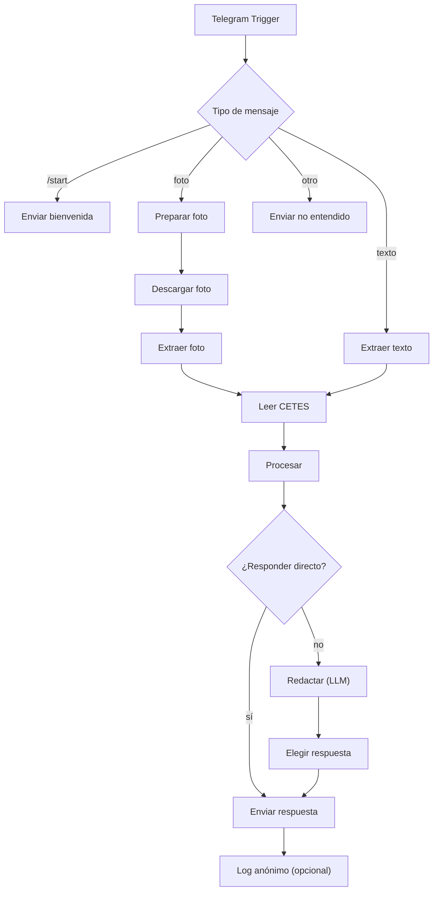

# Guía para armar Cuentas Claras en n8n

Esta guía arma el flujo con los módulos que ya están hechos y probados (157 pruebas en verde). El código se pega en **solo dos nodos Code**; el resto son nodos normales de n8n.

> Lo no comprobado está marcado **POR VERIFICAR**. Lo que sí se verificó contra la documentación de n8n o contra las APIs queda dicho. No he podido ejecutar este flujo en un n8n real, así que la primera ejecución es la prueba de verdad.

---

## 0. Antes de empezar

| Necesitas | Cómo conseguirlo | Estado |
|---|---|---|
| Un n8n en marcha | El que ya tienes | — |
| Un bot de Telegram | En Telegram, habla con **@BotFather**, comando `/newbot`; te da un token | **POR VERIFICAR** que lo tengas |
| Una dirección pública HTTPS para n8n | Telegram avisa de los mensajes por *webhook*, que necesita una URL pública con HTTPS. Si n8n corre en tu computadora, hace falta un túnel | **POR VERIFICAR** cómo lo tienes |
| Token de Banxico | Ya lo tienes (variable `BANXICO_TOKEN`); lo usarás como credencial de n8n | Hecho |
| Un modelo de IA **con visión** | El que ofrezca Clara en el evento, o uno propio | **POR VERIFICAR** cuál |
| Node.js (solo si vas a cambiar código) | Ya está instalado en esta máquina (v24) | Hecho |

## 1. Qué archivo va en qué nodo

| Archivo del proyecto | Dónde se usa |
|---|---|
| `n8n/nodos/procesar.js` | Se **pega entero** en el nodo Code **"Procesar"** |
| `n8n/nodos/elegir-respuesta.js` | Se **pega entero** en el nodo Code **"Elegir respuesta"** |
| `extraccion/prompt-extraccion.md` (el bloque *System*) | Instrucciones de los nodos **"Extraer foto"** y **"Extraer texto"** |
| `respuesta/prompt-redaccion.md` (el bloque *System*) | Instrucciones del nodo **"Redactar (LLM)"** |

Los dos archivos de `n8n/nodos/` están **generados**: no se editan a mano (salvo la zona de configuración que ellos mismos marcan, ver sección 7). Si cambias un módulo, los regeneras (sección 11).

## 2. Mapa del flujo



Los nombres de los nodos **importan**: `Procesar` lee a `Extraer foto`, `Extraer texto` y `Telegram Trigger` por su nombre, y `Elegir respuesta` lee a `Procesar`. Cópialos tal cual.

## 3. Credenciales

Crea tres en n8n (menú de credenciales):

1. **Telegram API**: pega el token que te dio @BotFather.
2. **Header Auth** para Banxico: *Name* `Bmx-Token`, *Value* tu token de Banxico. Guárdalo aquí y **no** en el flujo.
3. **La del modelo de IA** que uses.

No guardes ningún token dentro de los nodos Code ni en archivos del proyecto.

## 4. Privacidad primero (hazlo antes de probar con fotos)

n8n guarda por defecto los datos de cada ejecución, y ahí quedarían la foto y el texto de las personas. En el flujo, menú **Workflow → Settings**. Estos ajustes existen (verificado en la documentación de n8n); los valores exactos de los menús pueden variar según tu versión:

| Ajuste | Valor |
|---|---|
| Save failed production executions | No guardar |
| Save successful production executions | No guardar |
| Save manual executions | No guardar |
| Save execution progress | No guardar |
| Redact production execution data | Redact (oculta entradas y salidas) |
| Redact manual execution data | Redact |

Dos advertencias:

- Si dejas "Redact" activo no verás los datos de las pruebas en el editor. Para depurar, desactívalo **solo** con datos de prueba y vuelve a activarlo.
- Los datos "fijados" (*pinned data*) en un nodo **sí se guardan** en el flujo. No fijes fotos reales.

Y una aclaración honesta: nosotros no guardamos nada, pero **la foto y el texto sí viajan al proveedor del modelo de IA**. Revisa su política de retención y dilo en el pitch si preguntan.

## 5. Nodo por nodo

### 5.1 `Telegram Trigger`
- Credencial: la de Telegram. *Updates*: `message`.
- Activa el flujo (interruptor *Active*) para que Telegram empiece a avisar. Para pruebas, también puedes usar "Listen for test event".

### 5.2 `Tipo de mensaje` (Switch)
Tres salidas más la de reserva, **en este orden**:

| Salida | Condición | Va a |
|---|---|---|
| start | `{{ $json.message.text }}` es igual a `/start` | `Enviar bienvenida` |
| foto | `{{ $json.message.photo }}` no está vacío | `Preparar foto` |
| texto | `{{ $json.message.text }}` no está vacío | `Extraer texto` |
| reserva (*fallback*) | cualquier otra cosa (stickers, audios, etc.) | `Enviar no entendido` |

Los campos `message.photo`, `message.text` y `message.chat.id` son los de la API de Telegram. **POR VERIFICAR** con el primer mensaje real en la salida del trigger.

### 5.3 Rama de foto
**`Preparar foto`** (Code, "Run Once for All Items"). Telegram manda la foto en varios tamaños, de menor a mayor; tomamos el último:

```js
const fotos = $input.first().json.message.photo || [];
const mayor = fotos[fotos.length - 1];
return [{ json: { file_id: mayor ? mayor.file_id : null } }];
```

**`Descargar foto`** (Telegram): *Resource* File, *Operation* Get, *File ID* `{{ $json.file_id }}`, *Download* activado. (Parámetros verificados en la documentación.) La imagen queda como dato binario.

**`Extraer foto`** (nodo del modelo con visión):
- Instrucciones (*system*): el bloque **System** de `extraccion/prompt-extraccion.md`.
- Entrada: la imagen descargada (el dato binario del paso anterior).
- Temperatura al mínimo (0) si el nodo la ofrece.
- En *Settings* del nodo, activa **Retry On Fail** (2 o 3 intentos).
- El nombre exacto del nodo y de sus opciones depende del proveedor. **POR VERIFICAR** con el que uses.

### 5.4 Rama de texto
**`Extraer texto`**: el mismo modelo e instrucciones, y como mensaje del usuario `{{ $('Telegram Trigger').item.json.message.text }}`.

### 5.5 `Leer CETES` (HTTP Request)
Recibe las dos ramas de extracción (conecta **ambos** nodos de extracción a este).

| Campo | Valor |
|---|---|
| Method | GET |
| URL | `https://www.banxico.org.mx/SieAPIRest/service/v1/series/SF43936/datos/oportuno` |
| Authentication | Generic credential → Header Auth → la de Banxico |
| Settings → On Error | **Continue** (que el flujo siga aunque Banxico falle) |

Si Banxico falla, `Procesar` usa un respaldo local (6.22%, 29/10/2026) y la respuesta dice "dato de respaldo". Límites de la API (verificados): 80 consultas por minuto y 40,000 por día; para la demo no hace falta caché.

### 5.6 `Procesar` (Code)
Modo **Run Once for All Items**, lenguaje **JavaScript**. Pega **todo** el contenido de `n8n/nodos/procesar.js` (≈71,000 caracteres; **POR VERIFICAR** que tu n8n no ponga límite al tamaño). Va **justo después** de `Leer CETES`.

Qué hace: valida la extracción, calcula, asigna el semáforo, busca la entidad en tu tabla SIPRES y arma el contexto. Siempre devuelve un objeto con `accion`:

- `responder`: ya trae el `texto` final (preguntas, cobranza, errores).
- `redactar`: trae el `ctx` para el modelo de redacción, la `plantilla` de respaldo y el `log`.

### 5.7 `¿Responder directo?` (IF)
Condición: `{{ $json.accion }}` es igual a `responder`.
- **Verdadero** → `Enviar respuesta`.
- **Falso** → `Redactar (LLM)`.

### 5.8 `Redactar (LLM)`
- Instrucciones: el bloque **System** de `respuesta/prompt-redaccion.md`.
- Mensaje del usuario: `{{ JSON.stringify($json.ctx) }}`
- Temperatura baja. *Settings → On Error*: **Continue**: si el modelo falla, el siguiente nodo usa la plantilla sin IA y la persona igual recibe su respuesta.

### 5.9 `Elegir respuesta` (Code)
Modo **Run Once for All Items**. Pega `n8n/nodos/elegir-respuesta.js`. Va justo después de `Redactar (LLM)`. Revisa el texto del modelo con el verificador; si no cumple (cifras inventadas, palabras prohibidas, sin fuente o sin enlace), envía la plantilla. Devuelve `{ texto, origen, motivo, fallas }`.

### 5.10 `Enviar respuesta` (Telegram → Message → Send Message)
Recibe las dos rutas (la directa y la de `Elegir respuesta`).

| Campo | Valor |
|---|---|
| Chat ID | `{{ $('Telegram Trigger').item.json.message.chat.id }}` |
| Text | `{{ $json.texto }}` |
| Parse Mode | ninguno (texto plano) |
| Opciones adicionales | desactiva el pie "enviado con n8n" si el nodo lo agrega (**POR VERIFICAR** el nombre de la opción) |

### 5.11 Mensajes fijos
Dos nodos Telegram → Send Message con texto fijo (Chat ID igual que arriba):

**`Enviar bienvenida`**
```
Hola, soy Cuentas Claras 👋
Mándame una foto de una etiqueta de abonos o de la oferta de un préstamo, o escríbeme los datos (precio, pagos y plazo), y te digo cuánto cuesta de verdad.
No guardo fotos ni datos personales.
Hecho en el AI Hackathon por México: https://hackathon.clara.com/
```

**`Enviar no entendido`**
```
No pude entender ese mensaje. Mándame una foto o escribe los datos (precio, pagos y plazo).
Hecho en el AI Hackathon por México: https://hackathon.clara.com/
```

### 5.12 `Log anónimo` (opcional)
Un nodo de Google Sheets (o una tabla de n8n) que agregue una fila **después** de `Enviar respuesta`, con:

| Columna | Valor |
|---|---|
| fecha | `{{ $('Procesar').first().json.log.fecha }}` |
| tipo_entrada | `{{ $('Procesar').first().json.log.tipo_entrada }}` |
| semaforo | `{{ $('Procesar').first().json.log.semaforo }}` |
| estado_sipres | `{{ $('Procesar').first().json.log.estado_sipres }}` |

Ningún otro dato. Si no vas a mostrar métricas en la demo, omítelo.

## 6. Lista de conexiones

1. `Telegram Trigger` → `Tipo de mensaje`
2. `Tipo de mensaje`: *start* → `Enviar bienvenida`; *foto* → `Preparar foto`; *texto* → `Extraer texto`; reserva → `Enviar no entendido`
3. `Preparar foto` → `Descargar foto` → `Extraer foto`
4. `Extraer foto` → `Leer CETES` y `Extraer texto` → `Leer CETES`
5. `Leer CETES` → `Procesar` → `¿Responder directo?`
6. `¿Responder directo?`: verdadero → `Enviar respuesta`; falso → `Redactar (LLM)` → `Elegir respuesta` → `Enviar respuesta`
7. `Enviar respuesta` → `Log anónimo` (si lo usas)

## 7. Lo único que se edita a mano: la zona de configuración

Al final de `Procesar` hay un bloque **CONFIGURACIÓN DE ESTE FLUJO**:

- **`TABLA_SIPRES`**: la tabla de entidades que buscaste a mano en SIPRES. La fila que viene es **ficticia**: reemplázala. Cada fila:
  - `estado`: `registrada` o `no_registrada_confirmada`.
  - `terminos_buscados`: para confirmar "no registrada" hacen falta **al menos 2** (por ejemplo, nombre comercial y razón social). Con uno solo, el sistema la trata como "sin verificar".
  - `fecha_consulta`: la fecha en que hiciste la búsqueda, como `30/10/2026`.
  - Para la demo del caso rojo usa **solo entidades que tengan una alerta pública de Condusef** y guarda su enlace en `alerta_publica_condusef`.
- **`CONFIG.enlaceSipres`**: déjalo en `null` hasta que verifiques la dirección real de SIPRES. Mientras sea `null`, los mensajes dicen "verifícala en el SIPRES de Condusef" sin enlace.
- **`CONFIG.canalesCobranza`**: texto con los teléfonos y enlaces oficiales de Condusef y Policía Cibernética, **cuando los hayas verificado**. Mientras esté en `null` el mensaje de cobranza no incluye ningún teléfono.
- **`NODOS_EXTRACCION`**: los nombres de tus dos nodos de extracción, si decides cambiarlos.

Una entidad que **no está** en la tabla nunca se marca como "no registrada": queda "sin verificar" con un mensaje neutro.

## 8. Pruebas, en este orden

Escribe al bot en Telegram (en el editor, usa "Listen for test event" para ver cada nodo).

| # | Envía | Debe responder |
|---|---|---|
| 1 | `/start` | El mensaje de bienvenida |
| 2 | `Esta TV 55 pulgadas cuesta $7,999 de contado y la dan a $149 semanales por 104 semanas.` | Un 🔴 con $15,496 contra $7,999, $7,497 de más (93.7%), CAT ≈110.6%, la alternativa de ahorro y "Fuentes" con la fecha de Banxico |
| 3 | `Préstamo de $3,000. Recibes $2,100 y pagas $3,600 en 7 días. La app pide acceso a tus contactos.` | Un 🔴 con "Pide acceso a tus contactos", el depósito de $2,100 contra $3,000 y la nota de que la entidad no está en tu base. La cita entre « » puede variar según lo que copie el modelo |
| 4 | `Me amenazan y le escriben a mis contactos por un préstamo` | La plantilla de orientación (sin teléfonos mientras `canalesCobranza` sea `null`) |
| 5 | `hola` | Pide la foto o los datos |
| 6 | Una foto nítida de una etiqueta de prueba | Lo mismo que la prueba 2, con los precios de la foto |
| 7 | Una foto borrosa | Pide una foto más clara o los datos escritos |

Respuesta esperada de la prueba 2 con la tasa de CETES del 29/10/2026 (6.22%); con el valor vigente que traiga Banxico, las semanas y el ahorro cambian un poco:

```
🔴 En abonos pagas $15,496. De contado cuesta $7,999.
Son $7,497 de más (93.7%) repartidos en 104 semanas.
CAT implícito estimado: 110.6% anual (informativo, sin IVA; puede diferir del CAT oficial).
💡 Si apartas $149 cada semana, juntas el precio de contado en 53 semanas y evitas pagar ≈$7,599 de más.
📊 Fuentes: cálculo propio con los datos de la etiqueta; Banxico, CETES 28 días, subasta semanal (29/10/2026).
Hecho en el AI Hackathon por México: https://hackathon.clara.com/
```

Después, prueba los respaldos:

- **Banxico caído:** cambia el token de la credencial por uno inválido. La respuesta debe decir "dato de respaldo" y seguir funcionando. Restaura el token.
- **IA de redacción caída:** desactiva el nodo `Redactar (LLM)` o ponle una credencial mala (con *On Error: Continue*). Debe llegar la plantilla.
- **Privacidad:** abre la lista de ejecuciones del flujo y comprueba que **no** guardó entradas ni salidas.

## 9. Si algo falla

| Síntoma | Qué revisar |
|---|---|
| El bot nunca responde | ¿El flujo está activo? ¿La URL pública HTTPS de n8n está bien configurada? ¿La credencial de Telegram es la del bot correcto? |
| Error de nodo inexistente en `Procesar` o `Elegir respuesta` | Los nombres de los nodos no coinciden. Deben ser exactamente `Extraer foto`, `Extraer texto`, `Procesar` y `Telegram Trigger` |
| Siempre contesta "Algo falló de nuestro lado" | El modelo no devolvió un JSON utilizable. Abre la salida del nodo de extracción: ¿el texto está en `output`, `text` u otro campo? El código entiende los formatos más comunes, pero no todos |
| Siempre dice "dato de respaldo" | `Leer CETES` falló: revisa la credencial Header Auth (`Bmx-Token`) y que la URL termine en `/series/SF43936/datos/oportuno` |
| El mensaje no es el del modelo sino la plantilla | Normal si el verificador lo rechazó. Para ver por qué, mira `fallas` en la salida de `Elegir respuesta` (con "Redact" desactivado y datos de prueba) |
| Pregunta lo mismo una y otra vez | Cada mensaje se procesa solo (no hay memoria entre mensajes, a propósito, por privacidad). Pide al usuario que mande **todos** los datos en un solo mensaje |
| Mide mal una foto | Prueba con una más nítida y de frente. Si el monto sigue mal, es la extracción del modelo, no el cálculo |

## 10. Lo que sigue POR VERIFICAR con tu n8n

- El campo de salida de tu nodo del modelo (el código prueba `output`, `text`, `response`, `content`, `message.content`, `choices[0]` y `content[0].text`).
- Los campos que trae el trigger de Telegram para foto y texto.
- Los nombres exactos de los ajustes de cada nodo en tu versión (en particular *On Error* y el pie "enviado con n8n").
- Que n8n acepte un nodo Code de ≈71,000 caracteres.
- La URL pública HTTPS para el webhook de Telegram.
- Que la serie `SF43936` sea una tasa **anual**: su título en la API no lo dice.

## 11. Cuando cambies código

Desde la carpeta del proyecto:

```bash
node --test                    # todas las pruebas deben pasar
node scripts/empaquetar.js     # regenera n8n/nodos/*.js
```

Después vuelve a pegar el contenido de `n8n/nodos/procesar.js` y `n8n/nodos/elegir-respuesta.js` en sus nodos **y conserva tu `TABLA_SIPRES` y tu `CONFIG`** (cópialas antes de pegar). Una prueba falla si los archivos generados quedaron desactualizados respecto a los módulos.
